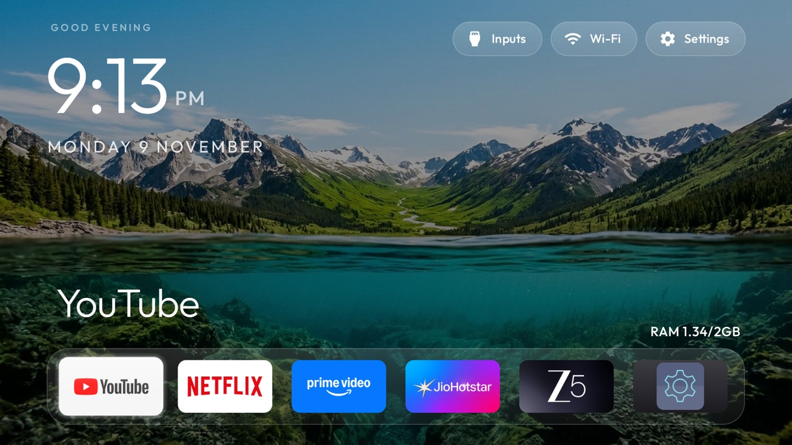
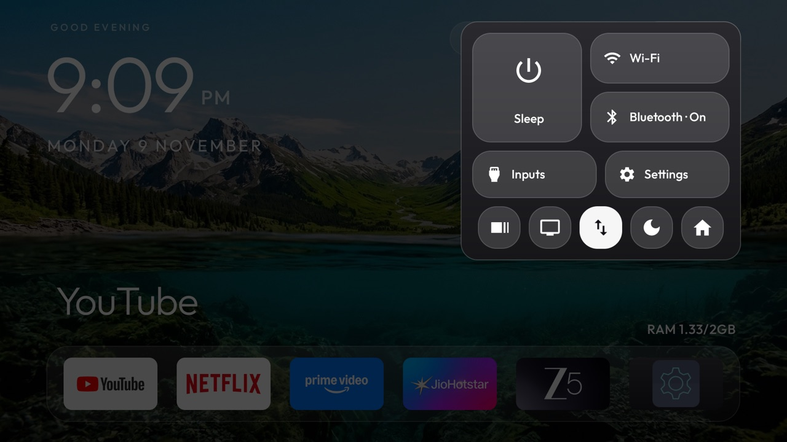
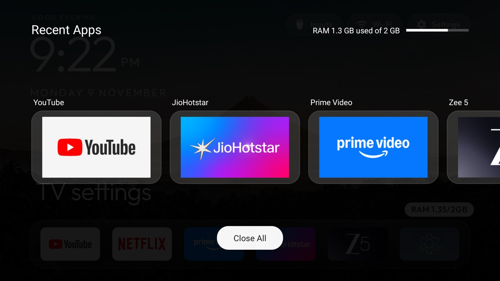
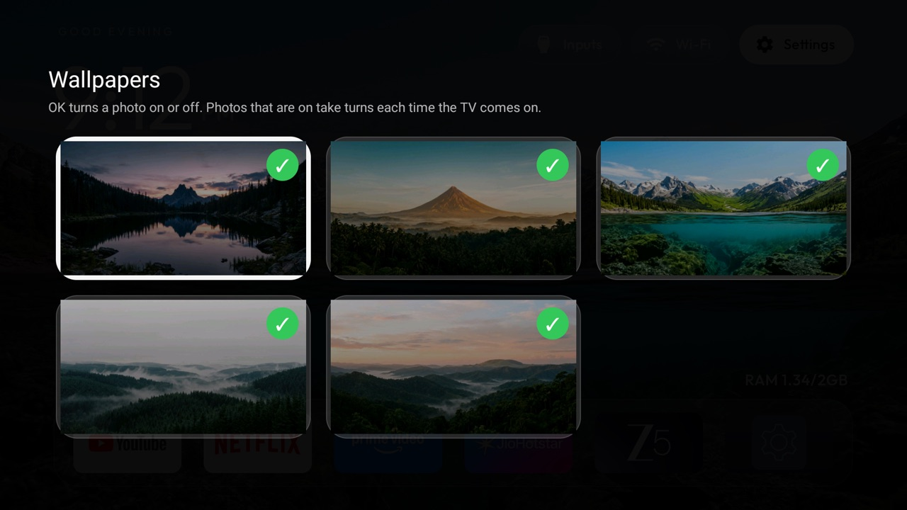
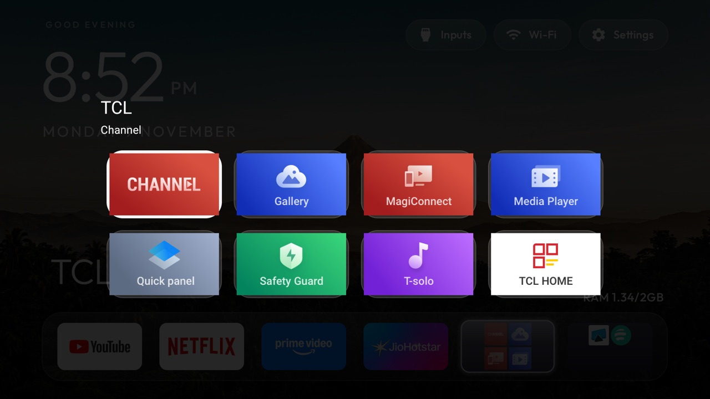
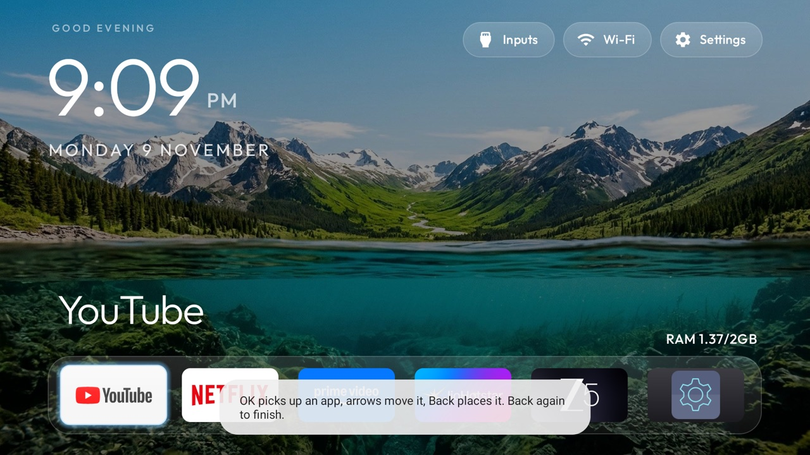
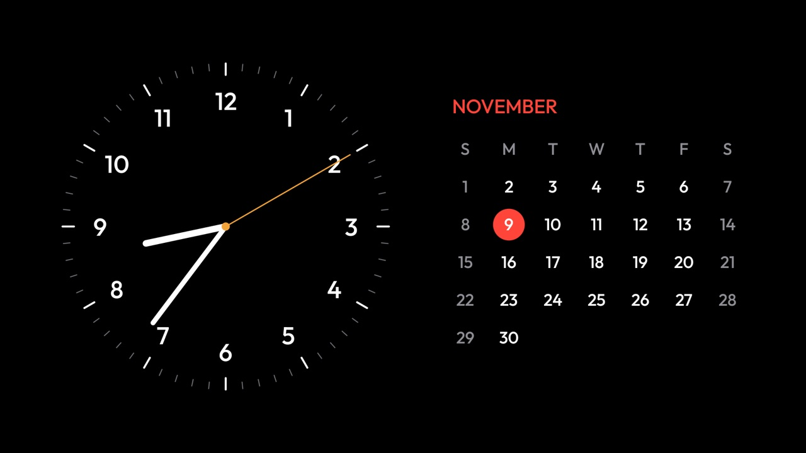

# CleanHome TV

A small, fast home screen for Android TV and Google TV: a clean layout inspired by Apple TV, built to feel quick on TVs with only 2 GB of RAM.

It is a personal build of the native launcher from [cleanyourtv](https://github.com/Gathin23/cleanyourtv), with a dock, Control Center, clocks, folders and app closing added.



## Why it is fast

It is plain Java with native views: no web view, no live blur and no video backgrounds. Everything heavy loads only when you ask for it.

Measured on one TCL/iFFalcon TV (Android 11, 2 GB RAM) while moving through the dock:

| | |
|---|---|
| App size | about 600 KB |
| Typical time to draw a frame | 5–7 ms |
| Late frames in the test | 0 |
| Memory used by the launcher | about 55–100 MB |

## Features

- **Dock along the bottom:** large, readable app banners, with the wallpaper left visible. Press Down for all your apps at the same size.
- **Big clock and date,** with a small `RAM 1.33/2GB` line above the dock.
- **Wallpapers that change only when the TV turns on,** never on a timer. Tick the ones you want on the TV.
- **Control Center:** Sleep, Wi-Fi, Bluetooth, Inputs, Settings and shortcuts.
- **Recent Apps with Close All,** which closes apps idle in the background and frees their memory.
- **Continue Watching:** rest on a dock app for 5 seconds to see what you were watching, if that app shares it.
- **Folders** for tidying away apps you rarely open.
- **Clock screens:** digital, analog and calendar faces, shown after 10 idle minutes or by pressing Back on Home.
- **Rearrange apps from the remote.** No computer needed.
- **Dark Mode** for the tiles.

## Screenshots

| Control Center | Recent Apps and Close All |
|---|---|
|  |  |

| Choosing wallpapers | Folders |
|---|---|
|  |  |

| Rearranging apps | Calendar clock |
|---|---|
|  |  |

## Using it with the remote

| To do this | Press |
|---|---|
| Open an app | Move to it, then **OK** |
| See all apps | **Down** from the dock |
| Open Control Center | **Up** to the top row, then **OK** on **Settings** |
| Open Recent Apps | **Up** from the last dock tile, then **OK** on the RAM line |
| Close background apps | In Recent Apps, **Down** to **Close All**, then **OK** |
| Rearrange apps | Control Center, up/down arrows icon. **OK** picks up, arrows move, **Back** places, **Back** again finishes |
| Choose wallpapers | Control Center, screen icon. **OK** ticks or unticks |
| See Continue Watching | Rest on a dock app for 5 seconds, then **Up** |
| Open the clock | **Back** on Home. **Left** and **Right** change the face |

## Install

You need a computer with [adb](https://developer.android.com/tools/releases/platform-tools), JDK 17 or newer, and the Android SDK. The TV needs Android 8.0 or newer.

**1. Turn on network debugging on the TV.** Open Settings, go to About, and press OK on **Build** seven times. Then turn on **USB debugging** and network debugging in Developer options, and note the TV's IP address.

**2. Get the code.**

```sh
git clone https://github.com/ShantanuTaro/cleanhome-tv.git
cd cleanhome-tv
```

**3. Choose your apps.** In `launcher/app/src/main/res/values/config.xml`, set:

- `dock_apps`: the apps in your dock, in order.
- `latitude` and `longitude`: your city, used to time sunset for Dark Mode. Blank is fine.
- `stock_home_redirect`: your TV's built-in home app. The value included is for Google TV.

**4. Build it.**

```sh
export ANDROID_HOME=/path/to/android-sdk
(cd launcher && ./gradlew assembleRelease)
```

The build is signed with the Android debug key, which is fine for your own TV.

**5. Install it.** Replace the address with your TV's. The TV asks you to allow this computer the first time.

```sh
TV=192.168.1.50:5555
P=com.gathin.tvhome
adb connect $TV
adb -s $TV install -r launcher/app/build/outputs/apk/release/app-release.apk
adb -s $TV shell cmd package compile -m speed -f $P
adb -s $TV shell pm grant $P android.permission.READ_TV_LISTINGS
adb -s $TV shell appops set $P GET_USAGE_STATS allow
adb -s $TV shell cmd package set-home-activity --user 0 $P/.MainActivity
```

**6. Make the Home button open it.** This replaces any other accessibility services you have switched on.

```sh
adb -s $TV shell settings put secure enabled_accessibility_services $P/.HomeKeyService
adb -s $TV shell settings put secure accessibility_enabled 1
```

**7. Add the wallpapers and look.**

```sh
python3 -m venv tools/venv && tools/venv/bin/pip install -r tools/requirements.txt
TV_HOST=192.168.1.50 tools/theme.sh my-theme
```

**8. Allow Close All once.** The first time you press Close All, the TV asks whether to allow debugging. Tick **Always allow** and choose **Allow**.

### Optional: make the whole TV feel faster

Halve the system animations, and stop Google's home screen doing work in the background. Both can be undone.

```sh
adb -s $TV shell settings put global window_animation_scale 0.5
adb -s $TV shell settings put global transition_animation_scale 0.5
adb -s $TV shell settings put global animator_duration_scale 0.5
adb -s $TV shell cmd appops set com.google.android.apps.tv.launcherx RUN_ANY_IN_BACKGROUND ignore
adb -s $TV shell am set-standby-bucket com.google.android.apps.tv.launcherx restricted
```

Keep Google's home app installed and enabled, because the Home button passes through it.

## Good to know

- **Close All needs debugging access.** Android lets an ordinary app close only itself, so the launcher connects to the TV's own debugging port. The first-use approval gives the launcher shell-level access to the TV. It only uses that to close apps, and the key stays in the TV's secure storage. To cancel it, use **Revoke USB debugging authorizations** in Developer options, which removes your computer's approval too.
- **Leaving network debugging on** means the port stays open on your home network. Other devices still have to be approved on the TV.
- **Close All leaves some things running,** such as anything still active in the background and Google's hidden home screen.
- **Force-stopping the launcher** can disconnect the Home button. Run step 6 again, clearing the setting first with `settings delete secure enabled_accessibility_services`.
- **Tested on one TV.** Some parts are specific to TCL: the Bluetooth tile opens TCL's accessories page, and the dock includes TCL's settings app. On other brands, change those.

## Go back to the TV's own home screen

```sh
adb -s $TV shell settings delete secure enabled_accessibility_services
adb -s $TV shell pm uninstall com.gathin.tvhome
adb -s $TV shell cmd appops set com.google.android.apps.tv.launcherx RUN_ANY_IN_BACKGROUND allow
adb -s $TV shell am set-standby-bucket com.google.android.apps.tv.launcherx active
```

## What's in this repository

| Folder | What it is |
|---|---|
| `launcher/` | The home screen |
| `my-theme/` | Wallpapers and look used in the screenshots |
| `tools/`, `themes/`, `docs/`, `addons/`, `examples/`, `tests/` | From cleanyourtv, mostly unchanged |

The documents in `docs/` describe cleanyourtv and may not match this build. Some of the inherited tests check its original README and defaults, so they fail here.

## Credits and licence

- Launcher and tools by [Gathin](https://github.com/Gathin23/cleanyourtv), under the MIT licence.
- Wallpapers from [couch-tv](https://github.com/Seagey/couch-tv), which were AI-generated for that project and offered for any use.
- CleanHome TV is released under the [MIT licence](LICENSE).

This is an independent project, not affiliated with Apple, Google, TCL or any streaming service. Their names and logos belong to their owners.
